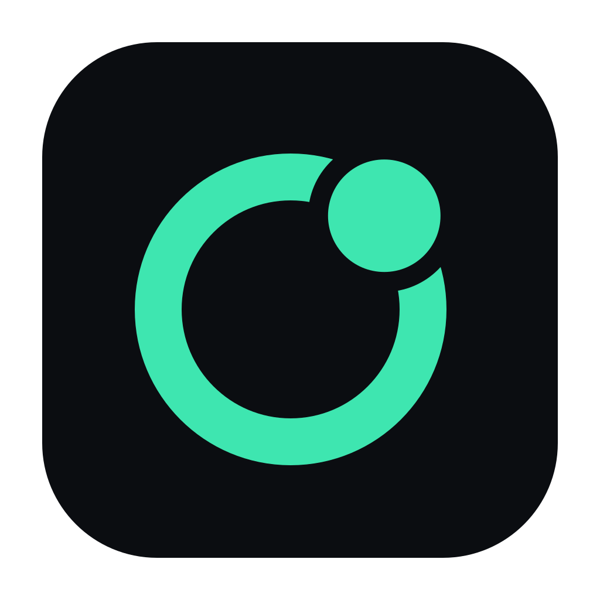

<p align="center">
  
</p>

<h1 align="center">Nexo</h1>

<p align="center">
  Self-hosted voice, chat and game streaming for a small group of friends.
</p>

<p align="center">
  <a href="https://github.com/campiohe/nexo/releases"></a>
  <a href="https://github.com/campiohe/nexo/actions/workflows/release.yml"></a>
  
  <a href="LICENSE"></a>
</p>

---

Nexo is a self-hosted desktop app for a small group of friends: text channels, voice channels, webcam,
and screen or game sharing at up to 1080p60 while the others watch. No accounts, no email: you pick a
name and a color, and the app remembers you. One friend hosts the server (a Linux box, a VPS, or a Windows
PC through WSL), and everyone else just installs the app.

## Features

- **Text channels** with message history, images (paste, drag or attach), and a quick switcher.
- **Voice channels** with webcam video and live presence.
- **Screen and game sharing** at up to 1080p60, with game audio on Windows.
- **Native capture engine** on Windows: hardware encoding that stays smooth while a game keeps the GPU busy, and no voice chat echo in your stream.
- **Push to talk** and **global keybinds** that work while a game has focus.
- **Noise suppression** (RNNoise) on by default.
- **Per-friend volume**, profile pictures, and a system tray mode.
- **Automatic updates** on Windows and the Linux AppImage (macOS gets notified), with an opt-in test build lane.

## Get Nexo

Download the installer for your system from **[Releases](https://github.com/campiohe/nexo/releases)**:
the Windows `.exe`, the macOS `.dmg` or the Linux `.AppImage`. After the first install, Nexo updates
itself.

The installers are **not code-signed**, so your OS warns you the first time. On Windows, click **More
info → Run anyway**. For macOS and Linux, see [Install](docs/USER-GUIDE.md#install).

Then ask your host for the server URL (it looks like `http://100.x.y.z:3001`), and enter it with a name
and a color.

## Host a server

The server is a small Node app plus [LiveKit](https://livekit.io) in Docker. It runs on any Linux host,
a VPS, or Windows through WSL, and friends usually reach it over [Tailscale](https://tailscale.com):

```bash
cp .env.example .env    # then set the LiveKit secret
npm install && npm run media && npm run start -w server
```

The full guide (systemd service, Tailscale or port forwarding, ports, bandwidth, backups and updates) is
in **[docs/SERVER.md](docs/SERVER.md)**.

## Develop

Dev setup, running the desktop client from WSL, the native share helper, tests and releases are in
**[docs/DEVELOPMENT.md](docs/DEVELOPMENT.md)**.

## Documentation

| Doc | For |
|---|---|
| [User guide](docs/USER-GUIDE.md) | Installing, settings, keybinds, updates, troubleshooting streams |
| [Server guide](docs/SERVER.md) | Hosting a server for your friends |
| [Development](docs/DEVELOPMENT.md) | Building, testing and releasing Nexo |
| [SPEC.md](docs/SPEC.md) | Architecture and design decisions |
| [SPEC-BETA.md](docs/SPEC-BETA.md) | The native Windows capture engine |

## License

[MIT](LICENSE) © 2026 Henrique Campiotti
