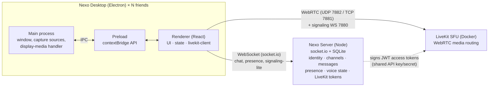
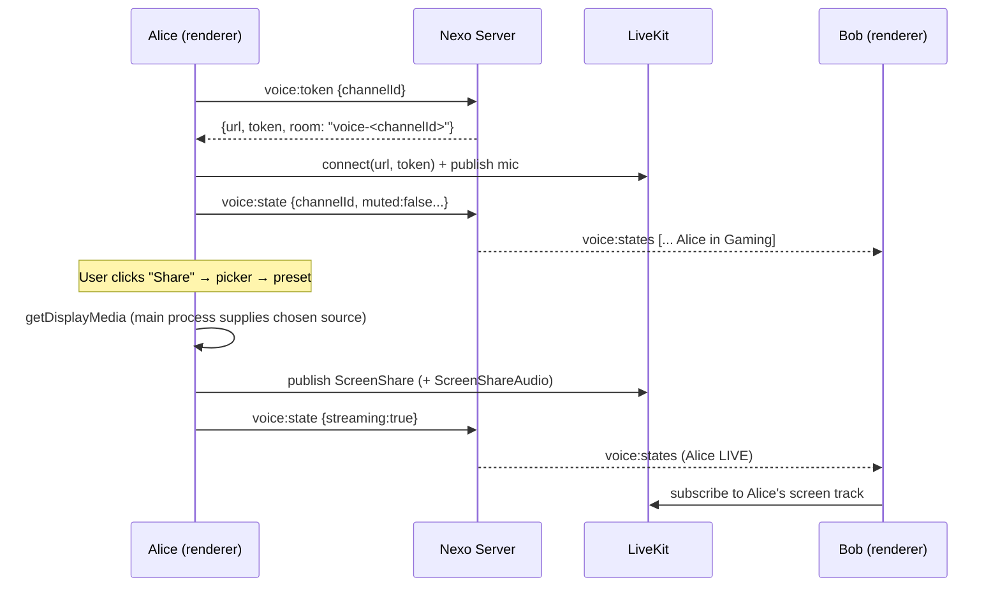

# Nexo — Architecture Spec

**Status:** Draft for review · **Date:** 2026-11-07

Nexo is a desktop app for small friend groups to chat, hang out in voice, and share their screen or a game while others watch.

> **Beta (v0.4):** on Windows, game and screen sharing moved to a native helper (WGC capture, hardware H.264,
> LiveKit C++ SDK). See [SPEC-BETA.md](SPEC-BETA.md). This document still describes everything else, and the
> Chromium capture path that remains the fallback and the engine on macOS and Linux.

---

## 1. Goals and non-goals

**Goals**

- One self-hosted "space" per group with **text channels** and **voice channels**.
- Low-friction identity: pick a name and a color, no email or password flow.
- **Screen and game sharing** that stays smooth at up to 1080p60, with game audio where the OS allows it.
- Up to ~10 people in one voice channel or watching one stream.
- Easy to run: one `docker compose` for media, one Node process for the app server.

**Non-goals (v1)**

- Many servers/guilds per user, public discovery, or large communities.
- Full account system (email, OAuth, password reset, 2FA).
- Mobile or web clients. The architecture keeps a web client possible later.
- End-to-end encryption of media. LiveKit supports E2EE, so it can be added later.
- Roles and permissions. Everyone in the space is trusted.

---

## 2. Product scope

### v1 features

| Area | Feature |
|---|---|
| Identity | Pick a display name and color on first launch. The device remembers a token. Optional server password for new members. |
| Text | Create, rename and delete text channels. Send and delete your own messages. Scrollback history, typing indicators, links that open in the browser. |
| Voice | Create, rename and delete voice channels. Join and leave. Mute, deafen, speaking indicator. The sidebar shows who is in each voice channel. |
| Video | Optional webcam in voice channels. |
| Sharing | Pick a screen or window from a thumbnail picker. Choose a quality preset. Optionally include system audio. Many viewers per stream. Click a stream to focus or go fullscreen. |
| Presence | Online/offline list. "LIVE" badge on users who are streaming. |
| Settings | Microphone and speaker selection, input volume test, server URL, change color. |

### Deferred (v2+)

Per-application audio capture (see §11), message editing, reactions, non-image file uploads, DMs, notifications and unread badges, E2EE, roles. (Auto-update shipped in v0.2; image attachments, global hotkeys and enhanced noise suppression are specified in §13 for v0.3.)

---

## 3. System architecture



There are three components, each with one job:

1. **Nexo Desktop** (Electron). The UI, capturing the screen, mic, camera and system audio, and rendering everyone else's media.
2. **Nexo Server** (Node + socket.io + SQLite). Owns all *non-media* state: users, channels, messages, presence, and who is in which voice channel. It issues LiveKit access tokens. Media never passes through it.
3. **LiveKit** (an open-source SFU, self-hosted in Docker). It receives each person's media once and forwards it to everyone else in the room.

### Why an SFU instead of peer-to-peer

With peer-to-peer, a streamer uploads one copy of the stream for every viewer. With an SFU, the streamer uploads once.

| 1080p60 stream at 8 Mbps, 9 viewers | Streamer upload | Server egress |
|---|---|---|
| P2P mesh | **72 Mbps** (unrealistic on home internet) | — |
| SFU (LiveKit) | **8 Mbps** | 72 Mbps (fine on a VPS) |

LiveKit also gives us bandwidth estimation, adaptive stream (paused video for hidden tiles), dynacast, reconnection, and Opus/RED for voice, without writing a custom WebRTC layer.

### Flow: join voice and start a stream



---

## 4. Desktop client

**Stack:** Electron + electron-vite + React + TypeScript + zustand + livekit-client + socket.io-client. Packaging with electron-builder (Windows NSIS, macOS dmg, Linux AppImage).

### 4.1 Process split

| Process | Responsibilities |
|---|---|
| **Main** | Creates the window with `contextIsolation: true` and `sandbox: true`. Grants `media` permissions. Lists capture sources with `desktopCapturer.getSources` (screens and windows, with thumbnails and icons). Implements `session.setDisplayMediaRequestHandler`, which answers the renderer's `getDisplayMedia` call with the **source the user picked** and `audio: 'loopback'` when system audio was requested. Opens external links in the default browser. |
| **Preload** | Exposes a small typed API on `window.nexo` through `contextBridge`: `listSources()`, `selectSource(id, withAudio)`, `platform`, `openExternal(url)`. |
| **Renderer** | All UI and app logic. Talks to the Nexo server over socket.io and to LiveKit through livekit-client. Has no Node access. |

### 4.2 Capture flow (custom picker)

1. The renderer calls `nexo.listSources()`. Main returns `[{id, name, kind, thumbnailDataUrl, iconDataUrl}]`.
2. The user picks a source, a preset, and whether to include audio. The renderer calls `nexo.selectSource(id, audio)`, and main stores it as the pending choice.
3. The renderer calls `navigator.mediaDevices.getDisplayMedia({ video: {width, height, frameRate}, audio })`.
4. Main's display-media handler resolves with the pending source and clears it.
5. The renderer sets `track.contentHint` (`motion` for games, `detail` for text and code) and publishes it to LiveKit.

On Linux Wayland, the OS (PipeWire portal) shows its own picker and step 1 is skipped.

### 4.3 State and modules (renderer)

```
src/renderer/src/
  net/socket.ts        socket.io client, typed emit-with-ack helper, reconnect handling
  store/app.ts         zustand: me, users, online, channels, messages by channel, typing, voice states
  store/settings.ts    persisted: server URL, token, devices, last channel, preferred preset
  voice/VoiceSession   wraps a LiveKit Room: join/leave, mic/cam, deafen, screen share,
                       exposes participants/tracks to React through a small store
  components/
    Onboarding         server URL + name + color (+ password)
    Sidebar            channel list, voice members under each voice channel, user panel
    TextChannel        message list (virtualized later), composer, typing line
    VoiceStage         participant tiles, stream tiles, focus/fullscreen
    SharePicker        source grid + preset + audio toggle
    Settings           devices, color, server
```

### 4.4 Layout

```
┌──────────────┬───────────────────────────────────────────┬────────────┐
│ NEXO         │ # general                                 │ Online — 4 │
│              │───────────────────────────────────────────│ ● Ana  LIVE│
│ TEXT       + │ Ana  21:04                                │ ● Bruno    │
│  # general   │   anyone up for a match?                  │ ● Caio     │
│  # clips     │ Bruno 21:05                               │ ○ Duda     │
│ VOICE      + │   joining Gaming                          │            │
│  🔊 Lounge   │                                           │            │
│  🔊 Gaming   │                                           │            │
│    Ana LIVE  │                                           │            │
│    Bruno 🔇  │ Caio is typing…                           │            │
│──────────────│───────────────────────────────────────────│            │
│ [In: Gaming] │ [ Message #general                    ⏎ ] │            │
│ 🎤 🎧 📷 🖥 ✕│                                           │            │
│ ● Me    ⚙   │                                           │            │
└──────────────┴───────────────────────────────────────────┴────────────┘
```

When you are viewing a voice channel, the center pane becomes the **stage**: a grid of streams and participant tiles. Clicking a stream focuses it (large tile with a strip of small tiles). Double-clicking goes fullscreen. You can keep watching a stream while reading a text channel through a small picture-in-picture panel (stretch goal for v1).

The visual design is Nexo's own: dark ink background, mint accent, rounded tiles.

---

## 5. Nexo Server

**Stack:** Node ≥ 23.6 running TypeScript directly (native type stripping, no build step), socket.io, `node:sqlite` (built in, so no native modules), and `livekit-server-sdk` for tokens.

### 5.1 Responsibilities

- Identity handshake (§7) during the socket.io `connect` middleware.
- Create, read, update, reorder and delete text and voice channels. Every change is broadcast to all clients.
- Persist messages (with replies, edits, mentions, reactions and pins). Serve history in pages of 50, keyed by
  timestamp, and full-text search (SQLite FTS5, §5.2) in pages of 25.
- **Presence:** in-memory map of userId to open socket count (online/offline), plus a `Presence`
  `{status: 'online'|'idle'|'dnd', activity: {name, startedAt} | null}` per socket (`DEFAULT_PRESENCE` =
  `{status: 'online', activity: null}` until that device sends `presence:update`; each device reports only
  its own state). The account's presence is the aggregate over its connected sockets: status `dnd` if any
  socket is dnd, else `online` if any is online, else `idle`; activity = the one with the latest `startedAt`.
  It is recomputed on every update, connect and disconnect, and `presence:changed` is broadcast only when the
  aggregate changed (`DEFAULT_PRESENCE` when the last socket leaves, so clients clear it); removing the
  account drops it silently (`user:removed` is enough). Bootstrap `presence` carries the non-default
  aggregates. Clients never adopt the aggregate as their own (per-device) status.
- **Voice state:** in-memory map of userId to `{channelId, muted, deafened, camera, streaming, watching, socketId}`. The client is the source of truth and re-sends its state after reconnecting. The entry is cleared when the owning socket disconnects.
- Issue LiveKit JWTs for room `voice-<channelId>` (identity = userId, name = display name, metadata = `{color}`).
- **Soundboard:** stores up to `MAX_SOUNDS` = 100 short clips (`sounds` table + `DATA_DIR/sounds/<id>`) and
  relays `sound:play` to the voice members of the caller's channel (§8). Cooldowns live in memory.
- **Link previews:** answers `GET /api/embed` from allowlisted oEmbed providers only, with an in-memory cache
  (§5.3).
- **Plugins:** built-in features admins/owner turn on or off for the whole server (`ServerPlugins`, stored as
  JSON in `meta.plugins`; missing or invalid values read as `DEFAULT_PLUGINS`, everything off): `music`,
  `games` and `emulator`.
- **Music plugin:** an in-memory `MusicState` per voice channel (queue, current track, timing), advanced on a
  timer; nothing is relayed through voice (§5.4).
- **Games plugin:** an in-memory game session per voice channel (lobby + the running match), simulated by the
  server at each game's tick rate (§5.5).
- **Emulator plugin:** an in-memory emulator session per voice channel (host, game title, controller ports); the
  server relays players' buttons to the host and never sees the game (§5.6).

### 5.2 Data model (SQLite)

```sql
users    (id TEXT PK, name TEXT UNIQUE NOCASE, color TEXT, token_hash TEXT UNIQUE, created_at INT,
          avatar TEXT NULL, role 'owner'|'admin'|'member',
          status_text TEXT NULL,                  custom status, NULL = none
          avatar_animated INT DEFAULT 0)          1 = the profile picture is a GIF
channels (id TEXT PK, name TEXT, type 'text'|'voice', position INT, created_at INT)
messages (id TEXT PK, channel_id → channels ON DELETE CASCADE, user_id → users,
          content TEXT, created_at INT,          INDEX (channel_id, created_at)
          edited_at INT NULL, reply_to_id TEXT NULL, reply_to_user_id TEXT NULL,
          mentions_everyone INT DEFAULT 0,       partial INDEX (channel_id, created_at) WHERE mentions_everyone
          pinned_by TEXT NULL, pinned_at INT NULL) partial INDEX (channel_id, pinned_at) WHERE pinned_at NOT NULL
                                                 INDEX (user_id, created_at), INDEX (created_at),
                                                 partial INDEX (edited_at) WHERE edited_at NOT NULL
message_search_ids (id INTEGER PK, message_id TEXT UNIQUE,   stable integer id of each message for the index
          indexed_edit INT NULL)                 the message's edited_at when its text was indexed
message_search     FTS5 (body), content='', contentless_delete=1, tokenize='unicode61 remove_diacritics 2';
                   rowid = message_search_ids.id; trigger message_search_on_delete AFTER DELETE ON messages
message_mentions (message_id → messages ON DELETE CASCADE, user_id → users ON DELETE CASCADE,
          PK (message_id, user_id))              INDEX (user_id)
reactions (message_id → messages ON DELETE CASCADE, emoji TEXT, user_id → users ON DELETE CASCADE,
          created_at INT, emoji_position INT, PK (message_id, emoji, user_id))
sounds   (id TEXT PK, name TEXT, emoji TEXT NULL, uploader_id → users ON DELETE CASCADE,
          duration_ms INT, type TEXT, size INT, created_at INT)   INDEX (uploader_id); file DATA_DIR/sounds/<id>
meta     (key TEXT PK, value TEXT)               'server_id' (permanent random id), 'plugins' (ServerPlugins JSON)
```

`reply_to_id` has no foreign key on purpose: when the original is deleted the reply keeps the id (and
`reply_to_user_id`, cleared when that account is removed) and reads back with a `deleted` preview.
**Pins.** `pinned_at` is kept strictly increasing (like `created_at`), so "most recently pinned first" has
no ties. When the pinner's account is removed the pin stays with `pinned_by = ''` (it was put there for the
channel, not for that person); its author or an admin can still unpin it.

**Search index.** `messages` has a TEXT primary key, so its implicit rowid can be renumbered by `VACUUM` and
can't key an external-content FTS table. Each message instead gets a stable `message_search_ids.id`
(INTEGER PRIMARY KEY), which is its rowid in `message_search`, a contentless FTS5 index (no second copy of
the text). The indexed text is the content in NFC with `<@userId>` mention tokens removed (ids are hex runs
that would match ordinary words). `messages.create` / `messages.edit` write the entry; the
`message_search_on_delete` trigger removes it however the message goes (`message:delete`, channel delete
cascade, account removal), so no code path can leave a stale entry. On every start `migrate()` indexes
messages that have no entry (the whole table once, on a database from before pins/search: about 0.1 s per
20 000 messages; afterwards only messages written by an older server after a downgrade), reindexes messages
whose `edited_at` differs from their entry's `indexed_edit` (edited by an older server after a downgrade;
found through the partial index on `edited_at`) and drops entries whose message is gone; when there's
nothing to do this costs a few milliseconds. Queries never reach `MATCH`
raw: they're split into words (runs of `\p{L}\p{N}\p{Co}` after NFC, like the tokenizer, first 10 kept),
each becomes `"word"*` and they're joined with `AND`. Results join back to `messages`, are ordered by the
index rowid descending and limited to `SEARCH_PAGE_SIZE + 1` (for `hasMore`), so FTS5 walks its matches
newest first and stops early instead of collecting and sorting all of them. That works because ids are
handed out in `created_at` order: new messages are always the newest, the backfill goes in `created_at`
order, and messages an older server wrote after a downgrade are newer than everything indexed before. A
`before` is turned into an id bound (the id of the first message at or after it, via `INDEX (created_at)`),
and `created_at < before` is kept too, so pages never overlap. (Only an older server whose clock went
backwards could write a message out of order; it may then show up out of place.) With 200 000 messages a
one-letter query takes about 5 ms on any page (150 ms when ordered by `created_at`). Filters that match
little (a quiet channel or author) still walk the word's matches, so `message:search` is rate-limited.

`emoji_position` is given when an emoji is first added to a message and shared by its rows, so an emoji keeps
its place while anyone still has it. Older databases gain the new columns and tables in place on start
(additive `migrate()` in `server/src/db.ts`).

On first run the server seeds `#general` and `#clips-and-memes` (text) and `Lounge` and `Gaming` (voice).

Voice, presence and music state stay in memory on purpose. They are temporary and rebuilt from live connections, so a server restart only makes clients reconnect and re-announce (music sessions are simply gone).

### 5.3 Why socket.io and not REST

All operations are small and need live fan-out. A single socket connection with acks handles request and response (`emit(event, payload, ack)`) as well as broadcasts, and socket.io adds reconnection and buffering. Plain HTTP is used only where it fits better than a socket: `GET /health`, and profile pictures (`PUT`/`DELETE /api/avatar` with the device token as a bearer token, and cacheable `GET /avatars/:userId?v=`). Pictures are WebP, PNG or JPEG up to 512 KB, or an animated GIF up to 2 MB (`AVATAR_ANIMATED_MAX_BYTES`; the user gets `avatarAnimated: true`, any other upload or a delete sets it back to false). The file's magic bytes must match its `Content-Type`, and the served type is sniffed from the stored file. Uploaded image bytes don't belong on the realtime socket.

**Link previews** (`GET /api/embed?url=<link>`, device token as bearer token → `200 {embed}` | `204` no
preview | `400 "Invalid link"` | `401` | `429`). This is an SSRF boundary: the server never fetches the link
itself, only a fixed oEmbed endpoint of an allowlisted provider, with a canonical link rebuilt from the parsed
one as a query parameter.

| Provider | Links (hosts matched exactly) | oEmbed endpoint | `kind` |
|---|---|---|---|
| YouTube | `(www\|m\|music.)youtube.com/watch?v=<id>`, `/shorts/<id>`, `/live/<id>`, `/embed/<id>`, `youtu.be/<id>` → `https://www.youtube.com/watch?v=<id>` | `https://www.youtube.com/oembed?format=json&url=` | video |
| Spotify | `open.spotify.com/[intl-xx/](track\|album\|playlist\|episode\|show)/<id>` | `https://open.spotify.com/oembed?url=` | audio |
| SoundCloud | `(www\|m.)soundcloud.com/<user>/<track>`, `/<user>/sets/<set>` | `https://soundcloud.com/oembed?format=json&url=` | audio |
| Vimeo | `(www.)vimeo.com/<id>[/<hash>]`, `/channels/<name>/<id>` | `https://vimeo.com/api/oembed.json?url=` | video |
| Reddit | `(www\|old\|new\|m.)reddit.com/r/<sub>/comments/<id>[/<slug>]` | `https://www.reddit.com/oembed?url=` | post |

Twitch (its oEmbed endpoint went away with the v5 API) and X/Twitter (HTML-only answers) aren't supported.
Rules: only `http:`/`https:` (else 400; also over 2048 characters); links with credentials, an explicit
port, another host (lookalikes such as `youtube.com.evil.com`, IP literals, `localhost`) or a path that
doesn't match → 204 without any request. The request has a 4 s timeout, refuses redirects, reads at most
256 KB and must be JSON. The answer becomes plain text (control/format characters removed, whitespace
collapsed): `title` ≤ 200 characters (none → 204), `author` ≤ 100 from `author_name`, and `thumbnail` only
for an https URL on the provider's CDN (`ytimg.com`, `scdn.co`/`spotifycdn.com`, `sndcdn.com`,
`vimeocdn.com`, `redditmedia.com`/`redd.it`), sizes defaulted when missing. Provider HTML is never returned.
`embed.url` echoes the link as asked. Results are cached in memory by canonical link (LRU, 500 entries; 24 h
for previews, 1 h for misses and failures), and concurrent requests for the same link share one lookup. Each
user may start 30 lookups per minute (cache hits and links without a provider don't count) → 429.

**Soundboard** (`POST /api/sounds?name=&emoji=` with the audio as body, `DELETE /api/sounds/:id`,
`GET /sounds/:id`). Uploads need the device token and must be 16-bit PCM WAV: `Content-Type` `audio/wav`
(`SOUND_TYPES`; else 415 "Sounds must be 16-bit PCM WAV audio (Content-Type audio/wav)"), at most
`SOUND_MAX_BYTES` = 512 KB (413 "Sounds are limited to 512 KB"). The server walks the RIFF chunks
(bounds-checked) and needs a `fmt ` chunk with PCM format 1, 1–2 channels, 8000–96000 Hz, 16 bits, followed
by a `data` chunk that fits in the file (else 415 "The file is not a valid WAV audio file"). The duration is
measured: data bytes / (rate × channels × 2). Over `SOUND_MAX_MS` = 5 s (+ 50 ms for encoder rounding;
judged on the header's claim, so a truncated file claiming an hour is also refused) → 400 "Sounds are
limited to 5 seconds"; no samples → 400 "The sound has no audio". The stored `durationMs` is the measured one
(clamped to 5000); a `durationMs` query parameter (still sent by the desktop client, which older servers require) is ignored. Clips stored
by older servers in other formats (OGG, MP3, WebM) keep being served with their type.
`name` is normalized like status text and must be 1..`SOUND_NAME_MAX` = 32 UTF-16 units (400 "Give the
sound a name" / "Sound names are limited to 32 characters"); `emoji` is optional, one `EMOJI_RE` emoji (400
"Invalid emoji"). A board with `MAX_SOUNDS` = 100 sounds →
409 "The soundboard is full (100 sounds). Delete one first" (checked again atomically with the insert).
10 uploads per user per minute → 429. The file is written to a temp file and renamed into place. Success:
`201 {sound}` and a `sound:upsert` broadcast. `DELETE` is for the uploader or admins/owner (403 "Only the
uploader or admins can delete this sound", 404 unknown) → 204 and `sound:deleted`. `GET /sounds/:id` needs
no auth (random UUID; other ids → 404 before touching the disk) and serves the stored type with
`cache-control: public, max-age=31536000, immutable` and `access-control-allow-origin: *` (clients fetch
and decode it with Web Audio). Removing an account deletes its sounds (rows, files, a `sound:deleted` each).
Files without a row and temp files are removed at start.

### 5.4 Music plugin (listen together)

**Shared state, local playback.** Each client in a voice channel fetches the YouTube Music track itself (InnerTube,
in the desktop main process) and plays it locally at the position the shared `MusicState` implies; no audio goes
through the server or LiveKit. The server (`server/src/music.ts`) only keeps, per voice channel and in memory,
`{current, queue, startedAt, pausedAt, rev}`: playing → position = serverNow − `startedAt`; paused → `pausedAt`.
Every change bumps `rev` (one server-wide counter seeded from the clock, so it never goes back, even when a session
ends and starts again or the server restarts) and is broadcast to everyone as `music:state` (the sidebar shows
what plays where); bootstrap `music` carries the sessions that show something.

**Server timing.** While playing, the queue advances at `startedAt + durationMs` + 750 ms of grace (clients start a
little late: fetch, buffering, network, so they finish the track naturally instead of being cut). The next track's
`startedAt` is the moment of the advance, not the previous track's nominal end: every client then starts it from
about 0, and nothing drifts since each track is re-anchored. An empty queue stops (`current` null). The last 20
played tracks are kept for `previous`. When the last person leaves the voice channel (leave, disconnect, move,
account removal) the session pauses at its position and is cleared after `MUSIC_IDLE_CLEAR_MS` = 30 min; someone
joining cancels the clear (it stays paused until someone presses play). Deleting the channel or turning the
plugin off ends its sessions (empty states broadcast).

**Client responsibilities.** Estimate the server clock offset with `time:now` (several round trips, keep the one
with the lowest RTT) and derive the position from it; seek when local playback drifts more than about a second;
ignore a `music:state` whose `rev` is lower than the one shown; replace all music state from bootstrap on every
(re)connect; treat `durationMs` as authoritative (stop at it, the server moves on); show `addedBy` even when the
account is gone. Search and stream fetching are entirely client-side; the server only validates `MusicTrackInfo`.

### 5.5 Games plugin (play together)

**Server-authoritative.** Each game is pure, deterministic logic in `shared/games/<id>/logic.ts` implementing
`GameDefinition` (`shared/games/types.ts`): `create(seats)`, `tick(state, {held, pressed})`, `action(state, seat,
move)` for turn-based games, `bot` / `botAction`, `leave`, `view(state, seat | null)` and `result`. The server
(`server/src/games.ts`) keeps one session per voice channel in memory, runs the match on a timer at the game's
`tickHz` (catching up at most 5 ticks after a stall, then dropping the backlog), and sends each person in that
voice channel (their voice-owning socket) a `games:frame` every `frameEvery` ticks and after each move: one view
for everyone, or one per seat when the game hides information (`perSeatView`, e.g. card hands; spectators get
`view(state, null)`). Randomness comes from a per-match seeded PRNG. Clients only draw the latest frames
(interpolating between two, placed on a timeline by tick number) and send input.

**Input.** `pad` games: the client sends its held buttons (`GAME_PAD` bits: d-pad, A, B, X, Y, L, R, Start, Select) on every
change (`games:input`, no ack, at most 120 per socket per second); the server keeps the last mask per seat and also
the buttons pressed since the previous tick (`pressed`), so a tap shorter than a tick is never lost. `actions`
games: `games:action` with a game-defined move; the game validates it and its refusal is the ack error.

**Session.** `games:open` creates the session (`status: 'lobby'`) with the caller as host and first player. People
take or give up seats (`games:join` / `games:leave`), the host sets `bots` (seats after the people; joining a full
table takes a bot's seat) and starts a match (`games:start`: seats = players in join order, then `CPU n`; colors
`GAME_SEAT_COLORS[seat]`; needs `minPlayers` people + bots and at least one person). A match ends when the game's
`result` is non-null, after `GAME_MAX_MATCH_MS` (30 min, nobody wins) or when every person in it left; the session
becomes `finished` with `result` (winners as seats, a summary line) and keeps its players for **Play again**. The host
(or an admin) may switch the game between matches (players beyond the new game's maximum lose their seat; bots are
clamped), abort a match (`games:stop`, back to `lobby`) or close the session (`games:close`). Leaving the voice
channel gives up your seat; in a running match that's a forfeit (`leave`, then `result` is checked). The host role
moves to the next seated player in the channel, else anyone in it; when the channel is empty the session closes.
Deleting the channel or turning the plugin off closes its sessions. Every lobby change bumps `rev` (one server-wide
counter seeded from the clock) and is broadcast to everyone as `games:lobby` (`status: 'closed'` when it ends);
bootstrap `games` carries the open sessions. Requests come only from the caller's voice-owning socket in that channel
("Join the voice channel to play"); lobby requests and moves share a limit of 40 per user per 10 s ("Slow down").

**Games.** All original designs in classic genres: `bomber` (Blast Arena, 2–4), `kart` (Kart Rally, 1–8), `brawl`
(Ring Out, 2–4), `fighter` (Dojo Duel, 2) and `cards` (Color Rush, 2–8). Every game must pass
`checkGameContract` (`server/test/helpers/gameHarness.ts`): views serializable and ≤ 16 KB, deterministic for a
seed, a match with bots ends on its own, people leaving never breaks it, junk moves are refused.

### 5.6 Emulator plugin (play along)

**The host runs the game.** In a voice call, the host loads a console game file (`system: 'snes'`) from their own
disk; their Nexo runs the emulator and publishes its picture and sound as their stream (LiveKit, like a screen
share). The others watch that stream and play along with their own controller. The server (`server/src/emulator.ts`)
only keeps, per voice channel and in memory, an `EmuSession` `{hostId, system, title, ports, paused, status, rev}`
and relays input; no game data ever goes through it.

**Privacy and game files.** The game file never leaves the host's device: it is not uploaded, stored or relayed,
only its display `title` (from the file name) and `system` are sent. Nexo never supplies, downloads or links to game
files; people play files they own.

**Session.** `emu:start` creates the session with the caller as host on port 0 (player 1); one session per voice
channel ("Someone is already hosting a game here"). The host may call it again after loading another game: the
title and system change, the session is unpaused and the ports stay. `title` is normalized like status text and must
be 1..`EMU_TITLE_MAX` = 80 UTF-16 units. There are `EMU_PORTS` = 4 controller ports: anyone in the channel takes a
free one or gives theirs up (`emu:port`); the host or an admin puts someone in the channel on a port, moving them
off any other one, or frees it (`emu:assign`); only the host pauses (`emu:pause`: shown to everyone, the host's
emulator actually pauses); the host or an admin ends it (`emu:stop`). The host leaving the voice channel (leave,
disconnect, move, account removal) closes the session; a player leaving frees their port. Deleting the channel or
turning the plugin off closes its sessions. Every change bumps `rev` (one server-wide counter seeded from the clock)
and is broadcast to everyone as `emu:session` (`status: 'closed'` when it ends); bootstrap `emulator` carries the
running sessions. Requests come only from the caller's voice-owning socket in that channel ("Join the voice channel
to play") and share a limit of 40 per user per 10 s ("Slow down").

**Input relay.** A player on a port sends their held buttons (`GAME_PAD` bits) on every change (`emu:input`, no ack,
at most 120 per socket per second, beyond that dropped); the server masks them with `GAME_PAD_MASK` and sends
`emu:input {channelId, port, buttons}` to the host's voice-owning socket only, and only when that port's buttons
changed. Whenever a port is freed (given up, reassigned, its player left) the host gets `buttons: 0` for it, so a held
button never sticks. The host's own controller is applied on their device and never goes through the server (their
`emu:input` is ignored, as is anyone's without a port). When the host's voice moves to another device, relays go to
that socket, which first gets every port's held buttons.

---

## 6. Media pipeline

### 6.1 Rooms

- One LiveKit room per voice channel: `voice-<channelId>`.
- Joining with `adaptiveStream: true` and `dynacast: true`. Viewers only receive video for tiles they can see, at the size they are shown.
- Mic: Opus with RED, echo cancellation, noise suppression and AGC on by default (configurable). Deafen sets every remote audio track's volume to 0 and also mutes the mic.

### 6.2 Screen share quality presets

| Preset | Resolution | FPS | Max bitrate | Content hint | Degradation preference | Use for |
|---|---|---|---|---|---|---|
| **Smooth** | 1280×720 | 60 | 4 Mbps | motion | maintain-framerate | Games on weaker upload |
| **Game** (default) | 1920×1080 | 60 | 8 Mbps | motion | maintain-framerate | Most games |
| **Sharp** | 1920×1080 | 30 | 5 Mbps | detail | maintain-resolution | Code, docs, slides |
| **Source** | 2560×1440 | 60 | 12 Mbps | motion | maintain-framerate | LAN or strong upload |

- **Codec:** H.264 first, because hardware encoding is common on gaming PCs and the CPU stays free for the game. VP8 is the fallback. VP9 and AV1 can be added later as a setting.
- **Simulcast:** off for screen shares by default (encoding several layers at 1080p60 costs the streamer). Turn it on when there are many viewers with mixed connections.
- **Stream audio:** published as a separate `ScreenShareAudio` track with the stereo music preset, DTX off, so viewers can control stream volume separately from voice.

### 6.3 System / game audio by platform

| OS | Video capture | System audio |
|---|---|---|
| Windows 10/11 | Screens and windows through desktopCapturer | ✅ `loopback` (whole system mix) |
| macOS 13+ | Screens and windows (needs Screen Recording permission) | ⚠️ supported in recent Electron through ScreenCaptureKit; to be verified |
| Linux X11 | Screens and windows | ❌ not through Electron loopback. Future: PipeWire per-app capture (the approach Vesktop's *venmic* uses) |
| Linux Wayland | Through the PipeWire portal picker | ❌ same as above |

### 6.4 Bandwidth budget (Game preset, 10 people)

- Streamer upload: ~8 Mbps video + 128 kbps audio + ~40 kbps voice.
- Each viewer download: ~8 Mbps while watching. Less with adaptive stream when the tile is small or hidden.
- SFU egress: about 9 × 8 Mbps ≈ **72 Mbps** per active stream. Easy on a VPS. Fine on most home fiber. Too much for a slow home upload if LiveKit runs at someone's house.

---

## 7. Identity and security

**Model:** "pick a name, the device remembers you."

1. On first launch the client connects with `auth = {name, color, password?}`.
2. The server checks the name (2–24 characters, unique, case-insensitive) and, if `SERVER_PASSWORD` is set, the password. It creates the user and a random 256-bit token, stores **only the SHA-256 of the token**, and sends the raw token once in `bootstrap.token`.
3. The client saves the token (via Electron `safeStorage` where available) and reconnects with `auth = {token}` from then on.

**Trade-offs:** there is no recovery if the token is lost. You pick a new name, or an admin CLI re-links the name (v2). One identity per device. Linking a second device with a code is a v2 option.

**Security measures for a friends server**

- The optional server password keeps strangers from joining when the server is reachable from the internet.
- LiveKit tokens are short-lived (12 h), limited to one room, and minted only for authenticated users. The LiveKit API secret never leaves the server.
- The renderer is sandboxed with context isolation and no Node integration. External links open in the system browser. A strict CSP is set.
- Message content is rendered as text, never as HTML. Links are detected and rendered safely.
- Input limits: 4000-character messages, 32-character channel names, 64 KB socket payloads.
- **Not covered:** abuse by trusted members (anyone can delete channels) and media E2EE. Both are accepted for v1.
- **Plain ws:// and http://** are fine on a LAN or Tailscale. A public deployment must put both behind TLS (Caddy in front: wss:// for the Nexo server and LiveKit).

---

## 8. Wire protocol (socket.io)

All shared types live in `shared/protocol.ts`, imported by both the server and the desktop app. Acks return `{ok: true, data} | {ok: false, error}`.

### Client → Server

| Event | Payload | Ack data |
|---|---|---|
| `channel:create` | `{name, type}` | `Channel` |
| `channel:rename` | `{channelId, name}` | `Channel` |
| `channel:delete` | `{channelId}` | `null` |
| `message:send` | `{channelId, content, attachmentIds?, replyToId?}` (`replyToId`: a message in the same channel, else "The message you replied to was not found") | `Message` |
| `message:edit` | `{messageId, content}` (author only; same content rules as send, `''` only with images; unchanged = no-op, no broadcast) | `Message` |
| `message:react` | `{messageId, emoji, on}` (one emoji, `EMOJI_RE`; idempotent; ≤ `MAX_REACTIONS_PER_MESSAGE` = 20 different emoji; 10 requests per 5 s per user) | `null` |
| `message:delete` | `{messageId}` (own only; admins/owner any) | `null` |
| `message:history` | `{channelId, before?}` | `Message[]` (oldest first, ≤ 50) |
| `message:pin` | `{messageId, pinned}` (anyone pins, up to `MAX_PINS_PER_CHANNEL` = 50 per channel: "This channel has 50 pinned messages. Unpin one first"; unpinning is for the pinner, the author or admins/owner: "Only the person who pinned it, its author or an admin can unpin it"; `pinned` not a boolean: "Invalid pin"; idempotent, no broadcast when nothing changed; otherwise broadcasts `message:updated`) | `null` |
| `message:pins` | `{channelId}` (a text channel, else "Channel not found") | `Message[]` (most recently pinned first, ≤ 50) |
| `message:search` | `{query, channelId?, authorId?, before?}`: case/accent-insensitive full-text search, every word must match as a prefix (§5.2). `query` ≤ `SEARCH_QUERY_MAX` = 200 characters ("Search is limited to 200 characters"); a query with no words ("", only punctuation) is allowed only with `authorId` (= that author's messages), else "Type at least one word to search". `channelId` must be a text channel ("Channel not found"). `before`: only messages created before it (paging). At most 10 searches per user (all devices) per 10 s: "Slow down: too many searches" | `SearchResult` `{messages, hasMore}` (newest first, ≤ `SEARCH_PAGE_SIZE` = 25; next page: `before` = last `createdAt`) |
| `channel:reorder` | `{type, ids}` (admins/owner; `ids` = every channel of that type exactly once, else "The channel list changed, try again"; positions become 0..n−1 in one transaction; broadcasts `channel:upsert` for each channel whose position changed) | `null` |
| `typing` | `{channelId}` | — |
| `voice:token` | `{channelId}` | `{url, token, room}` |
| `voice:state` | `{channelId \| null, muted, deafened, camera, streaming, watching?}` (`watching`: userIds whose stream you watch; the server only checks the shape: strings ≤ 64 characters, not yours, deduplicated, at most `MAX_WATCHING` = 16, an array longer than 64 is ignored; clients count a viewer only for a streamer in the same channel; missing = `[]`; `voice:move` clears it) | — |
| `voice:move` | `{userId, channelId}` (admins/owner; admins can't move the owner; same channel = no-op) | `null` |
| `voice:nudge` | `{userId}` (target in voice and muted or deafened; not yourself; once per `NUDGE_COOLDOWN_MS` = 15 s per sender → target) | `null` |
| `sound:play` | `{soundId}` ("Sound not found"; you must be in voice: "Join a voice channel to play sounds"; once per `SOUND_COOLDOWN_MS` = 2 s per user: "Wait a moment before playing another sound"). Sends `sound:played` to the voice-owning socket of everyone in your voice channel, you included | `null` |
| `plugins:set` | `{plugin, enabled}` (admins/owner: "Only admins can change plugins"; `plugin` not a `PluginId`: "Unknown plugin"; `enabled` not a boolean: "Invalid plugin setting"). Persisted; broadcasts `plugins:changed` when it changed. Turning `music` off ends every music session; turning `games` off closes every game session; turning `emulator` off ends every emulator session | `ServerPlugins` |
| `time:now` | `{}` | `{now}` (server clock, ms epoch) |
| `music:add` | `{channelId, tracks, next?}`: "The Music plugin is off"; a voice channel ("Voice channel not found"); you must be in it ("Join the voice channel to control its music"). `tracks`: 1..`MUSIC_MAX_ADD` = 100 ("You can add at most 100 tracks at once") valid `MusicTrackInfo` (else the whole call fails: "Invalid track"): `videoId` `/^[A-Za-z0-9_-]{11}$/`, `title` 1..200 and `artist` 0..200 UTF-16 units and `album` null or 0..200 (`''` → null) after normalizing like status text, `durationMs` an integer in 1000..`MUSIC_MAX_TRACK_MS` (3 h); `artwork` an https URL without credentials or port on `ytimg.com`, `*.ytimg.com` or `*.googleusercontent.com`, else null (never an error). Queue at most `MUSIC_MAX_QUEUE` = 200 ("The queue is full (200 tracks)"; a track that starts playing doesn't count). Appended (`next`: right after the current one); the first starts now when nothing plays. Shares the rate limit of `music:control`. Broadcasts `music:state` | `MusicState` |
| `music:control` | `{channelId, action, positionMs?, queueId?, toIndex?}` (same checks as `music:add`; 20 `music:add`/`music:control` per user per 10 s: "Slow down"). `play`/`pause` at the current position; `seek` to `positionMs` (a finite number, clamped to [0, `durationMs` − 1000]); `skip` plays the next track (stops at the end of the queue); `previous` plays the last played track within 3 s of the current one's start, else restarts it; `remove`/`move` a queued entry by `queueId` ("That track is no longer in the queue"; `move` needs a numeric `toIndex`, clamped); `clear` empties the queue (keeps the current track); `stop` ends the session. Bad action or parameter: "Invalid music action". A no-op (e.g. pause while paused) acks the state without a broadcast | `MusicState` |
| `games:open` | `{channelId, gameId}`: "The Games plugin is off"; a voice channel ("Voice channel not found") the caller is in from this socket ("Join the voice channel to play"); `gameId` in `GAME_IDS` ("Unknown game"). Creates the session (caller = host + first player), or (host/admins: "Only the host can do that"; not while playing: "A match is running. Stop it first") switches its game. 40 lobby requests + moves per user per 10 s ("Slow down"). Broadcasts `games:lobby` | `GameLobby` |
| `games:join` / `games:leave` | `{channelId}` (same checks; "No game is open in this channel"). Join: lobby or finished only, "All seats are taken" unless a bot gives up its seat. Leave: "You don't have a seat"; during a match it's a forfeit | `GameLobby` |
| `games:bots` | `{channelId, count}` (host/admins; not while playing; "This game has no computer players"; an integer ≥ 0, "Invalid number of bots"; players + bots ≤ max, "All seats are taken") | `GameLobby` |
| `games:start` / `games:stop` | `{channelId}` (host/admins). Start: players + bots ≥ `minPlayers` and ≥ 1 player ("This game needs at least N players (bots count)"), not while playing. Stop: "No match is running"; back to the lobby without a result | `GameLobby` |
| `games:close` | `{channelId}` (host/admins). Broadcasts the `closed` lobby | `null` |
| `games:input` | `{channelId, matchId, buttons}` (no ack): held `GAME_PAD` bits of your seat in that running `pad` match; anything else ignored; 120 per socket per second | — |
| `games:action` | `{channelId, matchId, action}`: one move of a running `actions` match ("No match is running", "You're not playing in this match", or the game's own refusal). Sends frames | `null` |
| `emu:start` | `{channelId, system, title}`: "The Emulator plugin is off"; a voice channel ("Voice channel not found") the caller is in from this socket ("Join the voice channel to play"); `system` in `EMU_SYSTEMS` ("Unsupported console"); `title` 1..`EMU_TITLE_MAX` = 80 after normalizing ("Invalid game title"). Creates the session (caller = host on port 0), or (the host only, else "Someone is already hosting a game here") changes its game and unpauses it. 40 `emu:*` requests per user per 10 s ("Slow down"). Broadcasts `emu:session` | `EmuSession` |
| `emu:port` | `{channelId, port}` (same checks; "No game is running in this channel"): `port` an integer 0..3 ("Invalid controller") that is free ("That controller is taken"), leaving your previous one; `null` gives yours up. A freed port relays `buttons: 0` to the host | `EmuSession` |
| `emu:assign` | `{channelId, port, userId}` (host/admins: "Only the host can do that"): `userId` in that voice channel ("They're not in this voice channel") goes on `port` (off any other; whoever was there loses it); `null` frees it | `EmuSession` |
| `emu:pause` | `{channelId, paused}` (host only; `paused` a boolean, "Invalid pause setting") | `EmuSession` |
| `emu:stop` | `{channelId}` (host/admins). Broadcasts the `closed` session | `null` |
| `emu:input` | `{channelId, buttons}` (no ack): your held `GAME_PAD` bits on your port, masked with `GAME_PAD_MASK`; relayed to the host when they changed; ignored from the host, without a port or from another socket; 120 per socket per second | — |
| `profile:update` | `{color?, statusText?}`, at least one ("Nothing to update"). `color` `#rrggbb` ("Invalid color"). `statusText` string or null ("Invalid status"): normalized (NFC, whitespace runs → one space, other `\p{C}` removed except the emoji ZWJ, trimmed), `''`/null clears it, longer than `STATUS_TEXT_MAX` = 64 UTF-16 units → "Status is limited to 64 characters". Broadcasts `user:upsert` | `User` |
| `presence:update` | `{status?, activity?}` (no ack). Omitted fields keep their value; invalid ones are ignored (`status` not in `online`/`idle`/`dnd`; `activity` not `null` or `{name, startedAt}` with a non-empty name and finite `startedAt`). The activity name is normalized like status text and cut to `ACTIVITY_NAME_MAX` = 64; `startedAt` is clamped to [now − 7 days, now]. Per connection (the account's presence is the aggregate over its sockets, see above). 20 updates per socket per minute; excess updates are delayed (merged) until the window allows, not lost. Broadcasts `presence:changed` only when the aggregate changed | — |

### Server → Client

| Event | Payload |
|---|---|
| `bootstrap` | `{serverName, me, token?, users, online, channels, voice, lastMessageAt, lastMentionAt, presence, sounds, plugins, music, …}` sent on every connect (`presence`: userId → `Presence` for online users whose presence isn't the default; `sounds`: the soundboard, oldest first; `plugins`: `ServerPlugins`; `music`: the `MusicState`s with a current track or a queue; `games`: the open `GameLobby`s; `emulator`: the running `EmuSession`s) |
| `user:upsert` | `User` |
| `presence` | `string[]` of online user IDs |
| `presence:changed` | `{userId, presence}` (`DEFAULT_PRESENCE` when they went back to plain online or offline) |
| `channel:upsert` / `channel:deleted` | `Channel` / `{channelId}` |
| `message:new` / `message:deleted` | `Message` / `{messageId, channelId}` (replies to it show a deleted preview) |
| `message:updated` | `Message` (an edit, pin or unpin, complete: replace in place) |
| `message:reactions` | `{messageId, channelId, reactions}` (the full new list; also sent for each message an account removal took reactions from) |
| `typing` | `{channelId, userId}` (clients show it for about 3 s) |
| `voice:states` | `VoiceState[]` (full list; small at this scale) |
| `voice:moved` | `{channelId, by}` to the target's voice-owning socket only: the server already moved its state (camera/stream off, mute/deafen kept); the client leaves the old room, joins `channelId` and re-announces `voice:state` |
| `voice:nudged` | `{by}` to the target's voice-owning socket only ("wake up" while muted or deafened) |
| `sound:upsert` / `sound:deleted` | `Sound` / `{soundId}` (a clip was added / deleted, also by an account removal) |
| `sound:played` | `{soundId, userId, channelId}` to the voice-owning sockets in that channel only; each client plays it locally (not through anyone's microphone) unless deafened |
| `plugins:changed` | `ServerPlugins` (an admin turned a plugin on or off) |
| `music:state` | `MusicState` to everyone, on every change of a voice channel's session (also its empty state when it ends: `current` null, `queue` []) |
| `games:lobby` | `GameLobby` to everyone on every lobby change of a voice channel's game session (`status: 'closed'` when it ends); not per frame |
| `games:frame` | `GameFrame` `{channelId, matchId, tick, view}` to the voice-owning sockets in that channel, at the game's rate and after each move (per seat for games that hide information) |
| `emu:session` | `EmuSession` to everyone on every change of a voice channel's emulator session (`status: 'closed'` when it ends) |
| `emu:input` | `{channelId, port, buttons}` to the host's voice-owning socket only: the buttons the player on `port` holds now (`0` when the port was freed) |

A `Message` carries, besides `content` and `attachments`: `editedAt` (null = never edited), `replyTo` (a
`ReplyPreview` `{id, userId, content ≤ 200 chars, hasAttachments, deleted}` or null), `reactions`
(`[{emoji, userIds}]`, emoji in first-added order, users in the order they reacted), `mentions`,
`mentionsEveryone` and `pinned` (`{by, at}` or null; `by` is '' once the pinner's account was removed).
Older servers omit them; clients default them.

**Mentions.** Content names people with the token `<@userId>` (`MENTION_TOKEN_RE`), which clients insert
from the @ autocomplete and render as "@Name", so renames keep working. The literal `@everyone` notifies
every account (anyone may use it). The server computes `mentions` on send and on every edit: the existing
accounts named by tokens, plus the author of the replied message, never the author, without duplicates.
Bootstrap `lastMentionAt` (channelId → createdAt of the newest message by someone else that mentions you or
@everyone) lets clients badge channels with an unread mention, like `lastMessageAt` for unread state.

Handshake errors arrive as `connect_error` with a readable message. `UNKNOWN_TOKEN` tells the client to clear its token and show onboarding again.

---

## 9. Repository layout

```
nexo/
  docs/SPEC.md            this document
  shared/protocol.ts      wire types and constants (types + a few consts)
  server/                 Node server (TypeScript run natively)
    src/index.ts          http + socket.io handlers
    src/db.ts             SQLite schema and queries
    src/config.ts         env config
  desktop/                Electron app
    src/main/             main process
    src/preload/          contextBridge API
    src/renderer/         React UI
    electron-builder.yml
  docker-compose.yml      LiveKit
  livekit.yaml            LiveKit config (ports, room limits)
  .env.example            shared config for server + LiveKit
  package.json            npm workspaces: server, desktop
```

> A first draft of the root config, `shared/protocol.ts` and `server/` already exists from an earlier start. It follows this spec and will be revised to match whatever changes come out of this review.

---

## 10. Deployment and networking

### Ports

| Port | Proto | Service |
|---|---|---|
| 3001 | TCP | Nexo server (socket.io) |
| 7880 | TCP | LiveKit signaling (WebSocket) |
| 7881 | TCP | LiveKit ICE/TCP fallback |
| 7882 | UDP | LiveKit media (single UDP port, easy to forward) |

### Local development (this machine: WSL2 + native Docker)

- Run LiveKit (`docker compose up -d`, host networking) and the Nexo server inside WSL.
- **Run the desktop app on Windows, not in WSL.** Electron under WSLg can only capture Linux windows, not Windows games, and has no system audio. Windows can reach WSL's IP directly (for example `http://172.26.x.x:3001`). Alternatively, use WSL mirrored networking and connect to `localhost`.
- For UI-only work, the desktop app also runs in WSLg.

### Hosting decision (v1): host PC + Tailscale

Nexo is hosted on the owner's own PC. LiveKit and the Nexo server run in Docker/Node inside WSL2, and friends reach them over **Tailscale**.

- **Tailscale runs inside WSL** (systemd is enabled), so WSL gets its own `100.x.y.z` tailnet IP. Friends connect to `http://<wsl-tailnet-ip>:3001`. The server then hands out `ws://<same-ip>:7880` for LiveKit automatically.
- LiveKit must advertise the tailnet IP as its ICE candidate (`LIVEKIT_NODE_IP` in `.env`). Otherwise it advertises the WSL NAT IP (`172.x`), which friends can't reach.
- The owner's Windows Nexo client connects to the same tailnet IP, or to the WSL `172.x` IP.
- Limits: Nexo is only available while this PC is on, and the home upload carries every stream (see §6.4). The same compose setup can move to a VPS later without app changes.

### Other hosting options (for later)

| Option | Effort | Notes |
|---|---|---|
| **Tailscale** (recommended to start) | Low | Everyone joins one tailnet and uses the host's 100.x IP. No port forwarding or TLS needed, and it is encrypted by WireGuard. |
| **Small VPS** (e.g. 2 vCPU / 2 GB) | Medium | Docker Compose with LiveKit, the Nexo server and Caddy for TLS. Set `use_external_ip: true`. Best for reliability and upload bandwidth. |
| **Home port forwarding** | Medium | Forward 3001, 7880, 7881 and 7882/udp. Limited by home upload (see §6.4). |

---

## 11. Risks and open questions

| # | Risk / question | Impact | Proposed handling |
|---|---|---|---|
| R1 | **Windows loopback captures the whole system mix**, including Nexo's own voice playback, so viewers hear the voice chat echoed in the stream. | High for game streaming | v1: document it and tell streamers to route Nexo's voice output to a different device than the default one (headphones alone don't help if they are the default device). Stream audio also requests `restrictOwnAudio`. Optionally mute stream audio for viewers who are in the same call. v2: native addon using the Windows *process loopback* API (Win10 2004+) to capture only the chosen game's audio, excluding Nexo. **Resolved on Windows in the beta** (SPEC-BETA §4.7): process loopback on Windows 10 2004+. |
| R2 | Linux has no system audio capture. | Medium | v2 PipeWire integration. Video works today. |
| R3 | Hardware H.264 encoding availability varies by GPU and driver in Electron/Chromium. | Medium | Fall back to VP8 automatically. Show the encoder in a "stream stats" overlay. Beta: the native engine picks the GPU's hardware encoder itself and falls back to the Chromium path when there is none. |
| R4 | macOS loopback audio support. | Low (friends mostly on Windows?) | Verify during implementation. Ship video-only on macOS if needed. |
| R5 | Lost device token means a lost identity. | Low | Admin CLI to reset a name (v2). |
| R6 | Code signing: unsigned Windows and macOS builds trigger SmartScreen and Gatekeeper warnings. | Low for friends | Accept for v1. Document "More info → Run anyway". |

**Decisions needed from you**

1. **Hosting:** start with Tailscale, a VPS, or port forwarding?
2. **Friends' OSes:** mostly Windows? (This affects how much effort goes into macOS and Linux audio.)
3. **Webcam in v1:** keep it, or ship voice + screen share only first?
4. **Permissions:** is "everyone can create and delete channels" OK, or should the first user be an admin?
5. **Game audio echo (R1):** is "use headphones" acceptable for v1, or is per-app audio capture a must-have now?

---

## 12. Next step

After this spec is reviewed, the implementation plan will split the work into parallel workstreams with clear interfaces (`shared/protocol.ts` is the contract between them). For example: server, Electron shell and capture, renderer chat UI, renderer voice and stage, and packaging/devops. Each workstream gets its own subagent.

---

## 13. v0.3: images in chat, global hotkeys, noise suppression

Three independent features. `shared/protocol.ts` and `desktop/src/preload/api.ts` remain the contracts.

### 13.1 Images in chat

**UX.** You can add images to the composer in three ways: paste (Ctrl/Cmd+V of an image or copied image
files), drag and drop onto the text channel, or the attach button (file picker). Each message can carry
**up to 4 images** plus optional text. Pending images show as thumbnails above the input, each with a
remove button and an upload progress indicator. Uploads start as soon as an image is added, and Send
waits for them. In the message list, images render below the text. They're laid out from the stored width
and height (no layout shift), up to 400×300 per image in a small grid. Clicking one opens a lightbox at
full size. Esc closes it, and it has an **Open original** button (system browser).

**Formats and limits.** PNG, JPEG, WebP and GIF (animated GIFs stay animated), at most
`ATTACHMENT_MAX_BYTES` = 10 MB each. The client re-encodes a still image over the limit (e.g. a 4K PNG
screenshot) to WebP at quality 0.9, longest side ≤ 4096 px, before uploading. A GIF over the limit is
rejected with a toast.

**Protocol** (`shared/protocol.ts`):
```ts
type AttachmentType = 'image/png' | 'image/jpeg' | 'image/webp' | 'image/gif'
interface Attachment { id: string; type: AttachmentType; width: number; height: number; size: number }
interface Message { …; attachments: Attachment[] }     // always present, [] for text-only
'message:send': { channelId, content, attachmentIds?: string[] }  // content may be '' when attachments exist
```

**HTTP** (like avatars, §5.3: bytes don't go over the socket):
- `POST /api/attachments` with `Authorization: Bearer <device token>`, the raw image bytes as the body,
  and a `Content-Type` of one of the types above. Returns `201 { attachment: Attachment }`. The server
  sniffs magic bytes (the Content-Type must match). It reads the width and height from the header (PNG
  IHDR, GIF logical screen, JPEG SOFn, WebP VP8/VP8L/VP8X) without decoding. It rejects files over the
  size limit and dimensions over 16384. It stores the file in `<dataDir>/attachments/<id>` with a
  random UUID as the id. The row is **pending** (`message_id` NULL) until a message claims it.
- `GET /attachments/:id` serves the bytes with the stored type, `Cache-Control: public, max-age=31536000,
  immutable` and `X-Content-Type-Options: nosniff`. There's no auth, so it works in `` tags. The
  128-bit random id is the capability, the same model as avatars. Unknown or pending ids return 404.
- `message:send` with `attachmentIds`: each id must exist, be pending and have been uploaded by the
  sender, with at most 4 ids and no duplicates. The message and the attachment links are written in one
  transaction.
- Cleanup:
  - Deleting a message deletes its attachment rows and files.
  - Deleting a channel does the same for all its messages.
  - Pending uploads older than 1 hour are removed by a sweep (on start, then every 10 minutes).
- DB: `attachments (id TEXT PK, message_id → messages ON DELETE CASCADE NULL, uploader_id → users,
  type TEXT, width INT, height INT, size INT, position INT, created_at INT)`, indexed by `message_id`.
- Rate limit: 20 uploads per minute per user (in memory).

**Compatibility.**
- An older client receiving a message with attachments shows only its text (which may be empty).
- A new client on an old server gets a 404 from `POST /api/attachments`. It shows "This server doesn't
  support images yet. Ask the host to update."

**CSP.** `img-src` already allows `http:`/`https:` (needed for user-entered server URLs). No change is
needed.

### 13.2 Global hotkeys (customizable)

**Actions.**
- *Global* (work while a game has focus, via the uiohook hook that push to talk already uses):
  - **Push to talk** (existing)
  - **Toggle mute**
  - **Toggle deafen**
  - **Toggle screen share**: stops the current share. Otherwise it restarts the last share (same source,
    with windows matched by title, same preset and audio) without any UI. It brings Nexo to the front with
    the share picker open only when there's nothing to restart.
  - **Leave voice**
- *In-app* (only while Nexo is focused, DOM keydown):
  - **Quick switcher** (default Ctrl/Cmd+K)
  - **Open settings** (default Ctrl/Cmd+,)

Global actions have no default binding, because any default would collide with some game.

**Binding format.** The existing `PttBinding` is generalized to
`Keybind { kind: 'key' | 'mouse'; code: number; mods: { ctrl, shift, alt, meta: boolean }; label }`.
Stored PTT bindings without `mods` load as no modifiers. A combination is matched when the main key or
button goes down while exactly those modifiers are held (left and right variants are equivalent).
Push to talk ignores modifiers held *in addition* to its own, so that PTT plus Shift still talks. Toggles
fire once per press, ignoring OS auto-repeat. Recording a binding captures the modifiers held with the
next non-modifier key or mouse button. A lone modifier (e.g. Left Ctrl) can also be bound by pressing
and releasing it alone. Escape cancels, and Backspace/Delete clears.

**Main process.** `ptt.ts` becomes `hotkeys.ts`:
- `setBindings({ ptt, toggleMute, toggleDeafen, toggleShare, leaveVoice })` keeps one hook running while
  any binding is set.
- `onAction(action, phase)` reaches the renderer over IPC.
- PTT keeps its pressed/released semantics.

Bridge: `nexo.hotkeys { setBindings, captureBinding, onAction, status }`. `nexo.ptt` is kept as a thin
alias until the renderer stops using it. Conflicts (the same combination on two actions) are rejected in
the UI. Platform limits are unchanged from push to talk: Wayland works only while focused, and macOS
needs the Accessibility permission.

**Settings.** A new **Keybinds** tab lists each action with **Record** / **Clear** and the current
combination, plus the in-app shortcuts with a **Reset to default**. Bindings persist in renderer
`localStorage` next to the input prefs, as PTT does today.

### 13.3 Noise suppression

**Settings → Audio & video → Noise suppression:**

| Mode | What it does |
|---|---|
| **Off** | `noiseSuppression: false` |
| **Standard** | Chromium's built-in suppressor. This is the current behaviour. |
| **Enhanced** (new default) | RNNoise: a small recurrent neural network running locally as WASM in an AudioWorklet. Chromium NS is turned off so the two don't stack. |

Echo cancellation and AGC stay on in every mode.

**Implementation.**
- Uses `@sapphi-red/web-noise-suppressor` (MIT): an RNNoise worklet plus the WASM and SIMD-WASM builds,
  bundled as app assets.
- Applied through LiveKit's audio `TrackProcessor` (`LocalAudioTrack.setProcessor`). The chain is
  mic MediaStreamTrack → AudioContext(48 kHz) → RnnoiseWorkletNode → MediaStreamDestination, and that
  destination becomes the processed track.
- Switching modes live re-applies the constraints and adds or removes the processor without leaving
  voice.
- The Audio & video **mic test** uses the same chain, so the difference can be heard before joining.
- If the WASM or worklet fails to load, Nexo falls back to Standard with a toast.
- Cost: about 1–2% of one core at 48 kHz mono.
- Push to talk and mute gate the processed track exactly as before.
- **CSP:** `script-src` gains `'wasm-unsafe-eval'`, which is required to compile WebAssembly. Worklet
  modules load from `'self'`.

