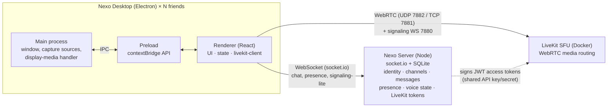
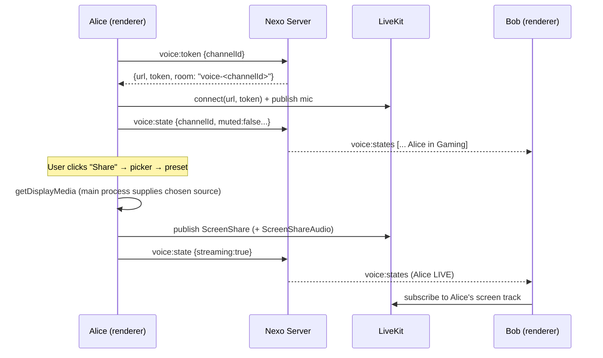

# Nexo — Architecture Spec

**Status:** Draft for review · **Date:** 2026-11-07

Nexo is a desktop app for small friend groups to chat, hang out in voice, and share their screen or a game while others watch.

---

## 1. Goals and non-goals

**Goals**

- One self-hosted "space" per group with **text channels** and **voice channels**.
- Low-friction identity: pick a name and a color, no email or password flow.
- **Screen and game sharing** that stays smooth at up to 1080p60, with game audio where the OS allows it.
- Up to ~10 people in one voice channel or watching one stream.
- Easy to run: one `docker compose` for media, one Node process for the app server.

**Non-goals (v1)**

- Many servers/guilds per user, public discovery, or large communities.
- Full account system (email, OAuth, password reset, 2FA).
- Mobile or web clients. The architecture keeps a web client possible later.
- End-to-end encryption of media. LiveKit supports E2EE, so it can be added later.
- Roles and permissions. Everyone in the space is trusted.

---

## 2. Product scope

### v1 features

| Area | Feature |
|---|---|
| Identity | Pick a display name and color on first launch. The device remembers a token. Optional server password for new members. |
| Text | Create, rename and delete text channels. Send and delete your own messages. Scrollback history, typing indicators, links that open in the browser. |
| Voice | Create, rename and delete voice channels. Join and leave. Mute, deafen, speaking indicator. The sidebar shows who is in each voice channel. |
| Video | Optional webcam in voice channels. |
| Sharing | Pick a screen or window from a thumbnail picker. Choose a quality preset. Optionally include system audio. Many viewers per stream. Click a stream to focus or go fullscreen. |
| Presence | Online/offline list. "LIVE" badge on users who are streaming. |
| Settings | Microphone and speaker selection, input volume test, server URL, change color. |

### Deferred (v2+)

Per-application audio capture (see §11), message editing, reactions, image/file uploads, DMs, notifications and unread badges, auto-update, E2EE, roles.

---

## 3. System architecture



There are three components, each with one job:

1. **Nexo Desktop** (Electron). The UI, capturing the screen, mic, camera and system audio, and rendering everyone else's media.
2. **Nexo Server** (Node + socket.io + SQLite). Owns all *non-media* state: users, channels, messages, presence, and who is in which voice channel. It issues LiveKit access tokens. Media never passes through it.
3. **LiveKit** (an open-source SFU, self-hosted in Docker). It receives each person's media once and forwards it to everyone else in the room.

### Why an SFU instead of peer-to-peer

With peer-to-peer, a streamer uploads one copy of the stream for every viewer. With an SFU, the streamer uploads once.

| 1080p60 stream at 8 Mbps, 9 viewers | Streamer upload | Server egress |
|---|---|---|
| P2P mesh | **72 Mbps** (unrealistic on home internet) | — |
| SFU (LiveKit) | **8 Mbps** | 72 Mbps (fine on a VPS) |

LiveKit also gives us bandwidth estimation, adaptive stream (paused video for hidden tiles), dynacast, reconnection, and Opus/RED for voice, without writing a custom WebRTC layer.

### Flow: join voice and start a stream



---

## 4. Desktop client

**Stack:** Electron + electron-vite + React + TypeScript + zustand + livekit-client + socket.io-client. Packaging with electron-builder (Windows NSIS, macOS dmg, Linux AppImage).

### 4.1 Process split

| Process | Responsibilities |
|---|---|
| **Main** | Creates the window with `contextIsolation: true` and `sandbox: true`. Grants `media` permissions. Lists capture sources with `desktopCapturer.getSources` (screens and windows, with thumbnails and icons). Implements `session.setDisplayMediaRequestHandler`, which answers the renderer's `getDisplayMedia` call with the **source the user picked** and `audio: 'loopback'` when system audio was requested. Opens external links in the default browser. |
| **Preload** | Exposes a small typed API on `window.nexo` through `contextBridge`: `listSources()`, `selectSource(id, withAudio)`, `platform`, `openExternal(url)`. |
| **Renderer** | All UI and app logic. Talks to the Nexo server over socket.io and to LiveKit through livekit-client. Has no Node access. |

### 4.2 Capture flow (custom picker)

1. The renderer calls `nexo.listSources()`. Main returns `[{id, name, kind, thumbnailDataUrl, iconDataUrl}]`.
2. The user picks a source, a preset, and whether to include audio. The renderer calls `nexo.selectSource(id, audio)`, and main stores it as the pending choice.
3. The renderer calls `navigator.mediaDevices.getDisplayMedia({ video: {width, height, frameRate}, audio })`.
4. Main's display-media handler resolves with the pending source and clears it.
5. The renderer sets `track.contentHint` (`motion` for games, `detail` for text and code) and publishes it to LiveKit.

On Linux Wayland, the OS (PipeWire portal) shows its own picker and step 1 is skipped.

### 4.3 State and modules (renderer)

```
src/renderer/src/
  net/socket.ts        socket.io client, typed emit-with-ack helper, reconnect handling
  store/app.ts         zustand: me, users, online, channels, messages by channel, typing, voice states
  store/settings.ts    persisted: server URL, token, devices, last channel, preferred preset
  voice/VoiceSession   wraps a LiveKit Room: join/leave, mic/cam, deafen, screen share,
                       exposes participants/tracks to React through a small store
  components/
    Onboarding         server URL + name + color (+ password)
    Sidebar            channel list, voice members under each voice channel, user panel
    TextChannel        message list (virtualized later), composer, typing line
    VoiceStage         participant tiles, stream tiles, focus/fullscreen
    SharePicker        source grid + preset + audio toggle
    Settings           devices, color, server
```

### 4.4 Layout

```
┌──────────────┬───────────────────────────────────────────┬────────────┐
│ NEXO         │ # general                                 │ Online — 4 │
│              │───────────────────────────────────────────│ ● Ana  LIVE│
│ TEXT       + │ Ana  21:04                                │ ● Bruno    │
│  # general   │   anyone up for a match?                  │ ● Caio     │
│  # clips     │ Bruno 21:05                               │ ○ Duda     │
│ VOICE      + │   joining Gaming                          │            │
│  🔊 Lounge   │                                           │            │
│  🔊 Gaming   │                                           │            │
│    Ana LIVE  │                                           │            │
│    Bruno 🔇  │ Caio is typing…                           │            │
│──────────────│───────────────────────────────────────────│            │
│ [In: Gaming] │ [ Message #general                    ⏎ ] │            │
│ 🎤 🎧 📷 🖥 ✕│                                           │            │
│ ● Me    ⚙   │                                           │            │
└──────────────┴───────────────────────────────────────────┴────────────┘
```

When you are viewing a voice channel, the center pane becomes the **stage**: a grid of streams and participant tiles. Clicking a stream focuses it (large tile with a strip of small tiles). Double-clicking goes fullscreen. You can keep watching a stream while reading a text channel through a small picture-in-picture panel (stretch goal for v1).

The visual design is Nexo's own: dark ink background, mint accent, rounded tiles.

---

## 5. Nexo Server

**Stack:** Node ≥ 23.6 running TypeScript directly (native type stripping, no build step), socket.io, `node:sqlite` (built in, so no native modules), and `livekit-server-sdk` for tokens.

### 5.1 Responsibilities

- Identity handshake (§7) during the socket.io `connect` middleware.
- Create, read, update and delete text and voice channels. Every change is broadcast to all clients.
- Persist messages. Serve history in pages of 50, keyed by timestamp.
- **Presence:** in-memory map of userId to open socket count.
- **Voice state:** in-memory map of userId to `{channelId, muted, deafened, camera, streaming, socketId}`. The client is the source of truth and re-sends its state after reconnecting. The entry is cleared when the owning socket disconnects.
- Issue LiveKit JWTs for room `voice-<channelId>` (identity = userId, name = display name, metadata = `{color}`).

### 5.2 Data model (SQLite)

```sql
users    (id TEXT PK, name TEXT UNIQUE NOCASE, color TEXT, token_hash TEXT UNIQUE, created_at INT)
channels (id TEXT PK, name TEXT, type 'text'|'voice', position INT, created_at INT)
messages (id TEXT PK, channel_id → channels ON DELETE CASCADE, user_id → users,
          content TEXT, created_at INT)          INDEX (channel_id, created_at)
```

On first run the server seeds `#general` and `#clips-and-memes` (text) and `Lounge` and `Gaming` (voice).

Voice and presence state stay in memory on purpose. They are temporary and rebuilt from live connections, so a server restart only makes clients reconnect and re-announce.

### 5.3 Why socket.io and not REST

All operations are small and need live fan-out. A single socket connection with acks handles request and response (`emit(event, payload, ack)`) as well as broadcasts, and socket.io adds reconnection and buffering. Plain HTTP is used only where it fits better than a socket: `GET /health`, and profile pictures (`PUT`/`DELETE /api/avatar` with the device token as a bearer token, and cacheable `GET /avatars/:userId?v=`). Uploaded image bytes don't belong on the realtime socket.

---

## 6. Media pipeline

### 6.1 Rooms

- One LiveKit room per voice channel: `voice-<channelId>`.
- Joining with `adaptiveStream: true` and `dynacast: true`. Viewers only receive video for tiles they can see, at the size they are shown.
- Mic: Opus with RED, echo cancellation, noise suppression and AGC on by default (configurable). Deafen sets every remote audio track's volume to 0 and also mutes the mic.

### 6.2 Screen share quality presets

| Preset | Resolution | FPS | Max bitrate | Content hint | Degradation preference | Use for |
|---|---|---|---|---|---|---|
| **Smooth** | 1280×720 | 60 | 4 Mbps | motion | maintain-framerate | Games on weaker upload |
| **Game** (default) | 1920×1080 | 60 | 8 Mbps | motion | maintain-framerate | Most games |
| **Sharp** | 1920×1080 | 30 | 5 Mbps | detail | maintain-resolution | Code, docs, slides |
| **Source** | 2560×1440 | 60 | 12 Mbps | motion | maintain-framerate | LAN or strong upload |

- **Codec:** H.264 first, because hardware encoding is common on gaming PCs and the CPU stays free for the game. VP8 is the fallback. VP9 and AV1 can be added later as a setting.
- **Simulcast:** off for screen shares by default (encoding several layers at 1080p60 costs the streamer). Turn it on when there are many viewers with mixed connections.
- **Stream audio:** published as a separate `ScreenShareAudio` track with the stereo music preset, DTX off, so viewers can control stream volume separately from voice.

### 6.3 System / game audio by platform

| OS | Video capture | System audio |
|---|---|---|
| Windows 10/11 | Screens and windows through desktopCapturer | ✅ `loopback` (whole system mix) |
| macOS 13+ | Screens and windows (needs Screen Recording permission) | ⚠️ supported in recent Electron through ScreenCaptureKit; to be verified |
| Linux X11 | Screens and windows | ❌ not through Electron loopback. Future: PipeWire per-app capture (the approach Vesktop's *venmic* uses) |
| Linux Wayland | Through the PipeWire portal picker | ❌ same as above |

### 6.4 Bandwidth budget (Game preset, 10 people)

- Streamer upload: ~8 Mbps video + 128 kbps audio + ~40 kbps voice.
- Each viewer download: ~8 Mbps while watching. Less with adaptive stream when the tile is small or hidden.
- SFU egress: about 9 × 8 Mbps ≈ **72 Mbps** per active stream. Easy on a VPS. Fine on most home fiber. Too much for a slow home upload if LiveKit runs at someone's house.

---

## 7. Identity and security

**Model:** "pick a name, the device remembers you."

1. On first launch the client connects with `auth = {name, color, password?}`.
2. The server checks the name (2–24 characters, unique, case-insensitive) and, if `SERVER_PASSWORD` is set, the password. It creates the user and a random 256-bit token, stores **only the SHA-256 of the token**, and sends the raw token once in `bootstrap.token`.
3. The client saves the token (via Electron `safeStorage` where available) and reconnects with `auth = {token}` from then on.

**Trade-offs:** there is no recovery if the token is lost. You pick a new name, or an admin CLI re-links the name (v2). One identity per device. Linking a second device with a code is a v2 option.

**Security measures for a friends server**

- The optional server password keeps strangers from joining when the server is reachable from the internet.
- LiveKit tokens are short-lived (12 h), limited to one room, and minted only for authenticated users. The LiveKit API secret never leaves the server.
- The renderer is sandboxed with context isolation and no Node integration. External links open in the system browser. A strict CSP is set.
- Message content is rendered as text, never as HTML. Links are detected and rendered safely.
- Input limits: 4000-character messages, 32-character channel names, 64 KB socket payloads.
- **Not covered:** abuse by trusted members (anyone can delete channels) and media E2EE. Both are accepted for v1.
- **Plain ws:// and http://** are fine on a LAN or Tailscale. A public deployment must put both behind TLS (Caddy in front: wss:// for the Nexo server and LiveKit).

---

## 8. Wire protocol (socket.io)

All shared types live in `shared/protocol.ts`, imported by both the server and the desktop app. Acks return `{ok: true, data} | {ok: false, error}`.

### Client → Server

| Event | Payload | Ack data |
|---|---|---|
| `channel:create` | `{name, type}` | `Channel` |
| `channel:rename` | `{channelId, name}` | `Channel` |
| `channel:delete` | `{channelId}` | `null` |
| `message:send` | `{channelId, content}` | `Message` |
| `message:delete` | `{messageId}` (own only) | `null` |
| `message:history` | `{channelId, before?}` | `Message[]` (oldest first, ≤ 50) |
| `typing` | `{channelId}` | — |
| `voice:token` | `{channelId}` | `{url, token, room}` |
| `voice:state` | `{channelId \| null, muted, deafened, camera, streaming}` | — |
| `profile:update` | `{color}` | `User` |

### Server → Client

| Event | Payload |
|---|---|
| `bootstrap` | `{serverName, me, token?, users, online, channels, voice}` sent on every connect |
| `user:upsert` | `User` |
| `presence` | `string[]` of online user IDs |
| `channel:upsert` / `channel:deleted` | `Channel` / `{channelId}` |
| `message:new` / `message:deleted` | `Message` / `{messageId, channelId}` |
| `typing` | `{channelId, userId}` (clients show it for about 3 s) |
| `voice:states` | `VoiceState[]` (full list; small at this scale) |

Handshake errors arrive as `connect_error` with a readable message. `UNKNOWN_TOKEN` tells the client to clear its token and show onboarding again.

---

## 9. Repository layout

```
nexo/
  docs/SPEC.md            this document
  shared/protocol.ts      wire types and constants (types + a few consts)
  server/                 Node server (TypeScript run natively)
    src/index.ts          http + socket.io handlers
    src/db.ts             SQLite schema and queries
    src/config.ts         env config
  desktop/                Electron app
    src/main/             main process
    src/preload/          contextBridge API
    src/renderer/         React UI
    electron-builder.yml
  docker-compose.yml      LiveKit
  livekit.yaml            LiveKit config (ports, room limits)
  .env.example            shared config for server + LiveKit
  package.json            npm workspaces: server, desktop
```

> A first draft of the root config, `shared/protocol.ts` and `server/` already exists from an earlier start. It follows this spec and will be revised to match whatever changes come out of this review.

---

## 10. Deployment and networking

### Ports

| Port | Proto | Service |
|---|---|---|
| 3001 | TCP | Nexo server (socket.io) |
| 7880 | TCP | LiveKit signaling (WebSocket) |
| 7881 | TCP | LiveKit ICE/TCP fallback |
| 7882 | UDP | LiveKit media (single UDP port, easy to forward) |

### Local development (this machine: WSL2 + native Docker)

- Run LiveKit (`docker compose up -d`, host networking) and the Nexo server inside WSL.
- **Run the desktop app on Windows, not in WSL.** Electron under WSLg can only capture Linux windows, not Windows games, and has no system audio. Windows can reach WSL's IP directly (for example `http://172.26.x.x:3001`). Alternatively, use WSL mirrored networking and connect to `localhost`.
- For UI-only work, the desktop app also runs in WSLg.

### Hosting decision (v1): host PC + Tailscale

Nexo is hosted on the owner's own PC. LiveKit and the Nexo server run in Docker/Node inside WSL2, and friends reach them over **Tailscale**.

- **Tailscale runs inside WSL** (systemd is enabled), so WSL gets its own `100.x.y.z` tailnet IP. Friends connect to `http://<wsl-tailnet-ip>:3001`. The server then hands out `ws://<same-ip>:7880` for LiveKit automatically.
- LiveKit must advertise the tailnet IP as its ICE candidate (`LIVEKIT_NODE_IP` in `.env`). Otherwise it advertises the WSL NAT IP (`172.x`), which friends can't reach.
- The owner's Windows Nexo client connects to the same tailnet IP, or to the WSL `172.x` IP.
- Limits: Nexo is only available while this PC is on, and the home upload carries every stream (see §6.4). The same compose setup can move to a VPS later without app changes.

### Other hosting options (for later)

| Option | Effort | Notes |
|---|---|---|
| **Tailscale** (recommended to start) | Low | Everyone joins one tailnet and uses the host's 100.x IP. No port forwarding or TLS needed, and it is encrypted by WireGuard. |
| **Small VPS** (e.g. 2 vCPU / 2 GB) | Medium | Docker Compose with LiveKit, the Nexo server and Caddy for TLS. Set `use_external_ip: true`. Best for reliability and upload bandwidth. |
| **Home port forwarding** | Medium | Forward 3001, 7880, 7881 and 7882/udp. Limited by home upload (see §6.4). |

---

## 11. Risks and open questions

| # | Risk / question | Impact | Proposed handling |
|---|---|---|---|
| R1 | **Windows loopback captures the whole system mix**, including Nexo's own voice playback, so viewers hear the voice chat echoed in the stream. | High for game streaming | v1: document it and tell streamers to route Nexo's voice output to a different device than the default one (headphones alone don't help if they are the default device). Stream audio also requests `restrictOwnAudio`. Optionally mute stream audio for viewers who are in the same call. v2: native addon using the Windows *process loopback* API (Win10 2004+) to capture only the chosen game's audio, excluding Nexo. |
| R2 | Linux has no system audio capture. | Medium | v2 PipeWire integration. Video works today. |
| R3 | Hardware H.264 encoding availability varies by GPU and driver in Electron/Chromium. | Medium | Fall back to VP8 automatically. Show the encoder in a "stream stats" overlay. |
| R4 | macOS loopback audio support. | Low (friends mostly on Windows?) | Verify during implementation. Ship video-only on macOS if needed. |
| R5 | Lost device token means a lost identity. | Low | Admin CLI to reset a name (v2). |
| R6 | Code signing: unsigned Windows and macOS builds trigger SmartScreen and Gatekeeper warnings. | Low for friends | Accept for v1. Document "More info → Run anyway". |

**Decisions needed from you**

1. **Hosting:** start with Tailscale, a VPS, or port forwarding?
2. **Friends' OSes:** mostly Windows? (This affects how much effort goes into macOS and Linux audio.)
3. **Webcam in v1:** keep it, or ship voice + screen share only first?
4. **Permissions:** is "everyone can create and delete channels" OK, or should the first user be an admin?
5. **Game audio echo (R1):** is "use headphones" acceptable for v1, or is per-app audio capture a must-have now?

---

## 12. Next step

After this spec is reviewed, the implementation plan will split the work into parallel workstreams with clear interfaces (`shared/protocol.ts` is the contract between them). For example: server, Electron shell and capture, renderer chat UI, renderer voice and stage, and packaging/devops. Each workstream gets its own subagent.
